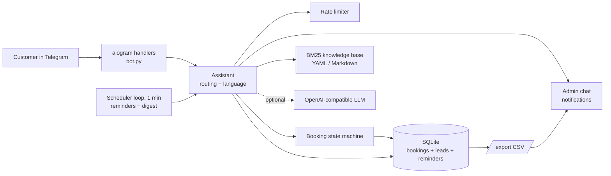

# Telegram AI Assistant Bot

Small businesses lose customers when messages go unanswered after hours and when booking means a phone call.
This bot answers questions from your own knowledge file in three languages, books appointments, and hands every lead to the owner.

## Features

- **FAQ answers from your knowledge file** (YAML or Markdown) using BM25 retrieval, with no model download and no GPU.
- **Optional LLM polish** through any OpenAI-compatible endpoint (OpenAI, OpenRouter, local Ollama or vLLM). Off by default; the bot works fully without a key. The model only sees retrieved facts, so it cannot invent policies.
- **Appointment reminders** 24 h and 2 h before the visit, in the customer's language. Reminder state lives in SQLite, so a restart never sends one twice. Offsets are set in the business config.
- **`/mybookings`**: the customer sees upcoming bookings with **Cancel** and **Reschedule** buttons. Cancelling frees the slot; rescheduling reuses the date/time dialog and moves the booking in one SQL statement, so the old slot is released only if the new one is won. The owner is notified about every cancel and reschedule.
- **No-show protection**: the last reminder (2 h) has **Confirm / Cancel** buttons, the booking records "confirmed", and the digest lists tomorrow's unconfirmed visits.
- **Owner daily digest** at a configured time: today's bookings, tomorrow's schedule, unconfirmed visits, new leads and open handoffs (a handoff closes when the owner answers with `/reply`).
- **EN / RU / HY replies**: language is detected by script and the dialog stays in the customer's language.
- **Booking flow**: service, date, time slot, name, phone, confirmation. Slots live in SQLite with a unique index, so double-booking is impossible even with two customers racing for one slot.
- **Lead capture** (`/lead`) and a **CSV export** for the owner (`/export` sends `leads.csv` and `bookings.csv`).
- **Owner notifications** in an admin chat for every booking, lead and handoff.
- **Human handoff** (`/human`): the owner is pinged with the customer's last message and can answer through the bot with `/reply <user_id> <text>`.
- **Rate limiting** per user, spreadsheet-formula-safe CSV, typed code, tests that need neither network nor a Telegram token.

## Architecture



`Assistant` and `BookingEngine` do not import Telegram, so the whole behaviour is unit-tested offline. The scheduler decisions are pure functions (`reminders.due_reminders(bookings, sent, now, offsets)` and `digest.build_digest(...)`); the aiogram loop only calls them once a minute.

## Quick start

### Local

```bash
git clone https://github.com/GEV44/telegram-ai-assistant-bot.git
cd telegram-ai-assistant-bot
python -m venv .venv && source .venv/bin/activate   # Windows: .venv\Scripts\activate
pip install -e ".[dev]"
cp .env.example .env        # set BOT_TOKEN (from @BotFather) and ADMIN_CHAT_ID
python -m tg_assistant
```

Run the checks: `ruff check . && pytest -q`.

### Docker

```bash
cp .env.example .env        # set BOT_TOKEN and ADMIN_CHAT_ID
docker compose up -d --build
```

The database is stored in a Docker volume; `config/` is mounted read-only so you can edit the FAQ and restart.

## Configuration

| Variable | Purpose | Default |
|---|---|---|
| `BOT_TOKEN` | Token from @BotFather | required |
| `ADMIN_CHAT_ID` | Chat or user that receives notifications and may run `/export` | none |
| `BUSINESS_CONFIG` | Business name, services, schedule | `config/smile_studio.yaml` |
| `KNOWLEDGE_FILE` | FAQ file (`.yaml` or `.md`) | `config/smile_studio_faq.yaml` |
| `DB_PATH` | SQLite file | `data/assistant.db` |
| `RATE_LIMIT_MESSAGES` / `RATE_LIMIT_WINDOW_S` | Messages allowed per user per window | `12` / `60` |
| `LLM_ENABLED`, `LLM_BASE_URL`, `LLM_API_KEY`, `LLM_MODEL` | Optional answer polishing | off |

Business config (`config/smile_studio.yaml`) options for the new features:

```yaml
reminders:
  offsets_hours: [24, 2]   # hours before the visit; the smallest one gets Confirm / Cancel buttons
digest:
  time: "20:00"            # local time of the owner digest; remove the block to turn it off
```

Reminders and the digest are sent from the bot's one-minute loop; the digest needs `ADMIN_CHAT_ID`. Times are the server's local time. Databases from version 1.0 are upgraded automatically on start.

Commands: `/start` `/help` `/book` `/mybookings` `/lead` `/human` `/cancel` `/services` `/hours`; owner only: `/export`, `/reply`.

## Adapting it for your business

The repository ships with a clearly fictional dental clinic, **Smile Studio**.

1. Copy `config/smile_studio.yaml` and edit the business name, services (names in each language), opening hours, weekdays, slot length and breaks.
2. Copy `config/smile_studio_faq.yaml` and replace the questions and answers. Add entries in the languages your customers use. Markdown also works: one `## Question` heading per entry, answer below.
3. Point `BUSINESS_CONFIG` and `KNOWLEDGE_FILE` at your files in `.env`.
4. Wording of the dialog lives in `src/tg_assistant/i18n.py`.

Different business, same engine: salons, repair shops, tutors, clinics, studios.

## Project layout

```
src/tg_assistant/   assistant.py  booking.py  reminders.py  digest.py  knowledge.py  db.py  llm.py  bot.py ...
config/             example business + FAQ
tests/              110 offline tests
```

## License

MIT

---

Built by Gevorg Hovhannisyan — AI engineer. Need a bot like this for your business? Portfolio https://gev44.github.io · Telegram @hovhannisyan77
